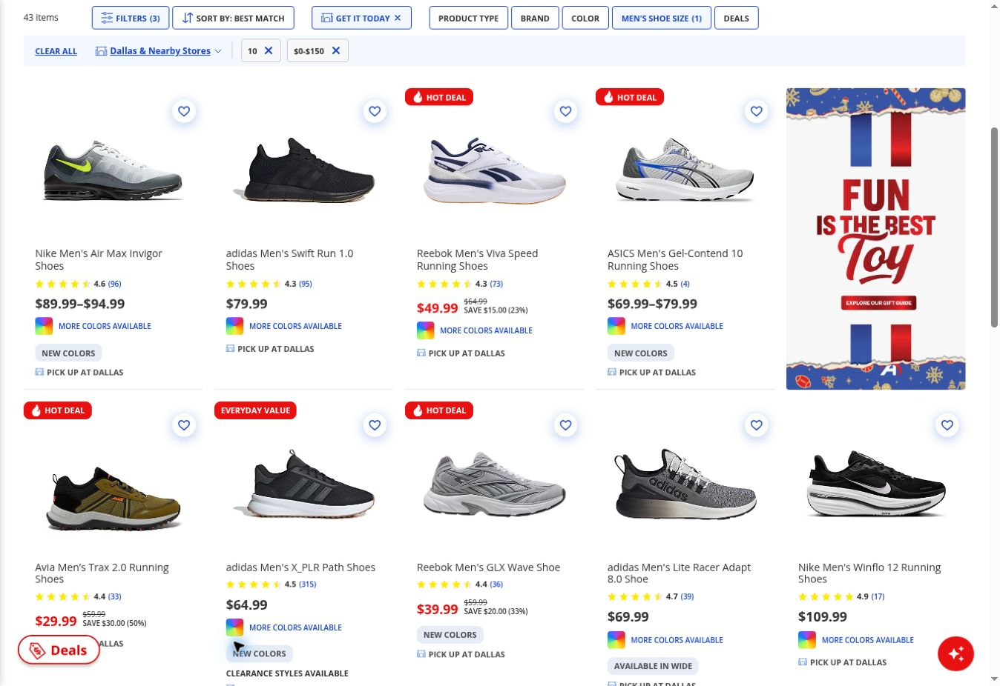
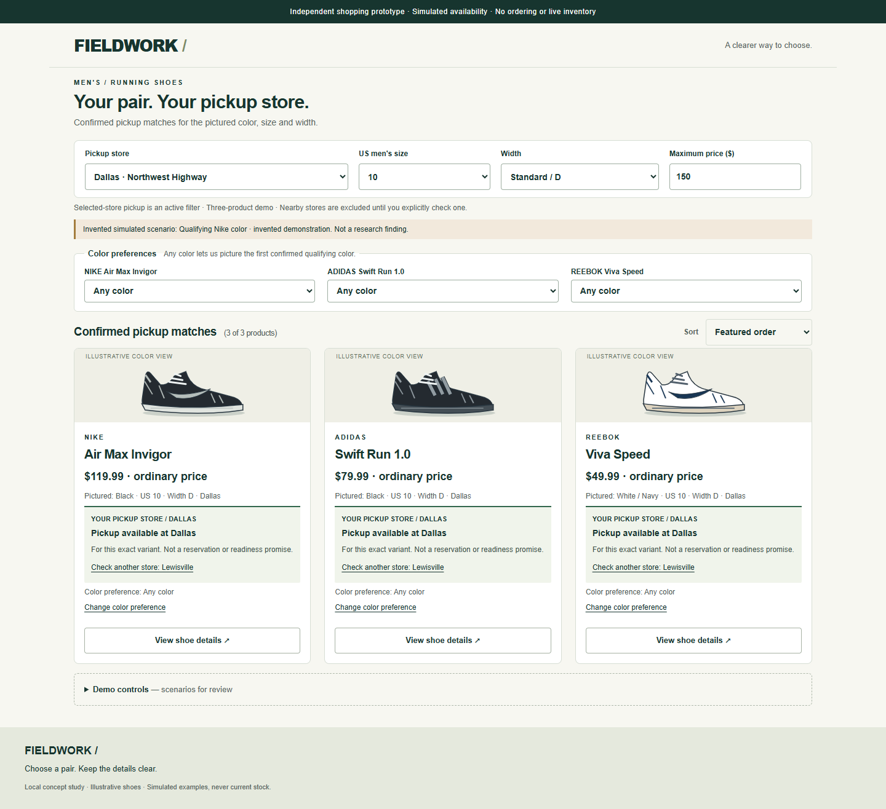
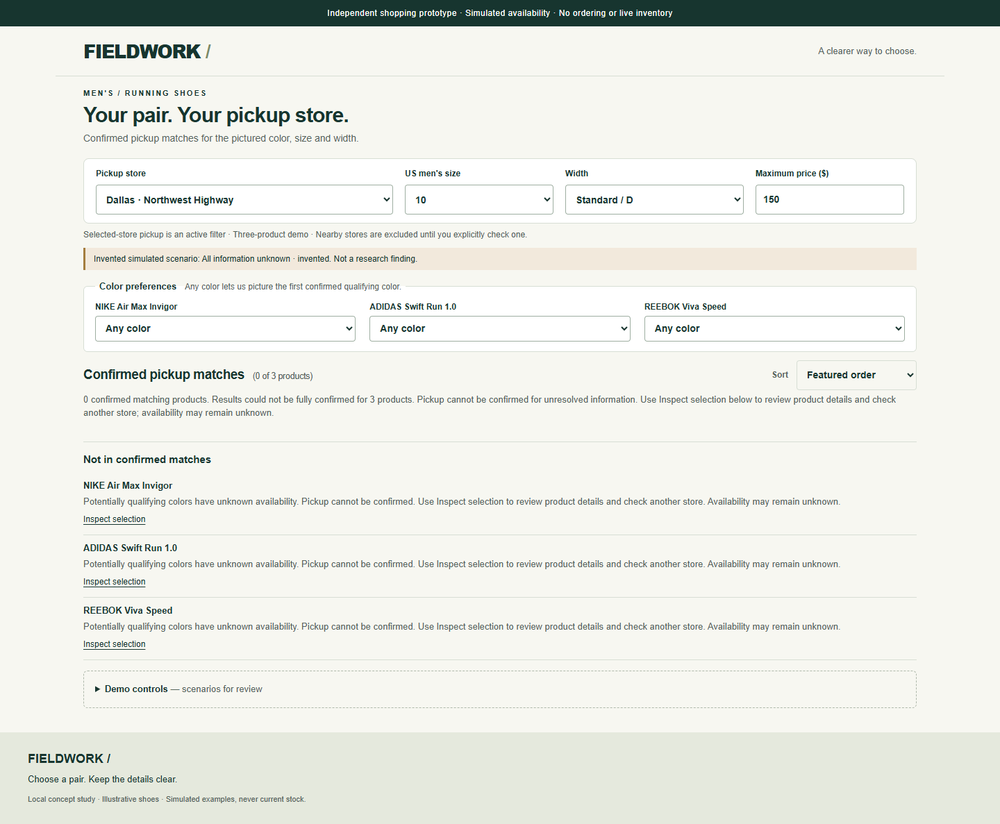

# Making pickup eligibility specific to the pictured shoe

*Andre Taylor · Independent undergraduate product management project · October 2026*

[Try the interactive prototype.](https://ajata21.github.io/retail-product-discovery/prototype/)

## Overview

A shopper wants men's running shoes in US size 10, within $150, for pickup near Dallas ZIP 75231. Can they tell whether a pickup label applies to the pictured color, selected size and chosen store together?

A shopper relying on a filtered card might expect the pictured shoe to qualify, then need to backtrack to results when details show otherwise. This is a plausible risk, not observed customer behavior or a documented wasted trip.

I explored that question across three sporting-goods retailers, then narrowed the concept to exact-variant pickup clarity. The result is a [working browser prototype](prototype/README.md) that pictures confirmed qualifying variants while respecting explicit color preferences. It uses simulated data, functional checks and internal review. Customer benefit remains unvalidated; this is not an official Academy, DICK'S or REI initiative.

## My role and AI-assisted workflow

I set the scenario, supplied initial walkthrough observations, reviewed evidence qualifications, chose the portfolio scope and challenged the first design. ChatGPT assisted research and analysis; the later pilot and Academy follow-up document observations from supplied ChatGPT Work sessions. Codex assisted documentation, implementation and functional checks. VS Code and GitHub Desktop supported the local editing and repository workflow.

This work does not imply that I manually wrote every line of code or personally reopened every external source. No customer interviews were conducted. Inspecting saved attachments was not independent verification of live retailer inventory.

## Starting broad, then narrowing to Academy

The [initial audit](research/competitive-ux-audit.md) compared DICK'S Sporting Goods, Academy Sports + Outdoors and REI under the same intended task. DICK'S exposed category and fulfillment choices; Academy offered custom price inputs; REI displayed running specifications. The [synthesis](research/competitive-ux-synthesis.md) raised candidate questions about exact-variant eligibility, budget clarity, selection continuity and pickup estimates.

This was not an equivalent competitive benchmark: price-band coverage, store scope and product checks differed. Academy became the focus because a later bounded desktop follow-up provided a concrete eligibility example, not because it ranked worst.

## Correcting the evidence before choosing a problem

Review narrowed several early interpretations. Still images establish page states, not automatic selection transfer. Initial Academy captures did not prove nearby stores were excluded. Different product counts could not rank retailers, and closed-store conditions complicated pickup-estimate interpretation.

The [public-feedback analysis](research/customer-feedback-analysis.md) was a convenience sample containing adjacent fulfillment/service complaints and app experiences. It did not validate the complete desktop discovery problem. One REI author understood the ready-email requirement; another found assembly information later in ordering. Positive Academy pickup and [REI discovery accounts](research/online-research-pilot.md#review-screening-log) also challenged broad failure claims.

The original search pass lacked complete screening provenance. [Amendment A-01](research/customer-feedback-protocol.md#amendment-a-01-purposive-source-verification) improved the proposed verification method without certifying execution. The later [pilot](research/online-research-pilot.md) logged six exact queries and 30 result positions, with exclusions and duplicates. It did not retroactively repair missing historical records or add rediscovered accounts to accepted-feedback totals.

## A specific Academy example, with successful comparisons

The October 20 [follow-up](research/academy-website-followup.md) fixed the first three filtered cards before opening products: Nike Air Max Invigor, adidas Swift Run 1.0 and Reebok Viva Speed. Nearby-store checkboxes were unchecked despite the chip still saying “Dallas & Nearby Stores.”

All three cards said pickup at Dallas. Nike Grey/Green, size 10/D, $94.99 instead showed unavailable Dallas pickup and nearby Lewisville availability in the documented product inspection. The explicit Dallas out-of-stock label is preserved in the supplied [browser-state JSON](research/evidence/2026-10-20-academy-followup/academy-followup-raw-20261020.json), not the follow-up Nike upper-panel screenshot.

adidas Black/10/D/$79.99 and Reebok White/Navy/10/D/$49.99 displayed Dallas eligibility. All three transferred size 10, retained filters on Back and did not reset to the top. These short first-row journeys did not disprove differently triggered app complaints.

*Historical capture, October 20: Nike Grey/Green, adidas Black and Reebok White/Navy cards each say “PICK UP AT DALLAS.” This listing does not establish their product-page pickup status; that evidence is linked above.*

The Nike repeat was not another independent customer experience. This check established no inventory-system cause, confusion rate, wasted trip or business impact. The [problem brief](product/problem-brief.md) therefore scoped an eligibility-clarity concept rather than inventory repair.

## The design decision that changed the project

The first prototype explained availability for the pictured variant. During review, I challenged the premise: why not initially picture a color that actually meets the filters? The revised [Product Requirements Document (PRD)](product/prd.md) combined selection and communication:

- **Any color:** picture the first confirmed qualifying variant in fixed catalogue order.
- **Explicit color:** respect that requirement; never silently substitute another color.
- **No qualifying variant:** exclude confirmed non-matches from selected-store results.
- **Unknown information:** distinguish uncertainty from a confirmed non-match.
- **Details:** preserve the pictured variant when opened.
- **Nearby stores:** require an explicit check; nearby availability cannot satisfy the chosen-store filter.

This depends on reliable variant/store data, freshness and coverage. It is not inherently easier to engineer; clearer product-family wording remains an alternative.

*Simulated prototype: invented Nike Black/10/D/$119.99 qualifies at Dallas under Any color. This and the historical capture are not a controlled before/after comparison; Black's availability and price are invented.*

## What I built and reviewed

The three-product browser demo separates historically inspired outcomes from invented alternate colors, prices and failure scenarios. Existing [fixture checks](prototype/tests/fixtures-check.cjs) contain 47 assertions; [Chrome checks](prototype/tests/browser-check.cjs) cover matching, preferences, uncertain states, store scope, Back and focus. The [verification notes](prototype/README.md) record passing checks at two viewport sizes, not customer usability results.

A reproduced nearby-navigation bug left Black's check indefinitely loading after details had checked Grey/Green. The correction refreshes the opted-in check for the displayed variant and rejects obsolete responses without expanding store scope.

In my October 21 guided walkthrough with ChatGPT, I reported identifying Nike Black's Dallas eligibility and retained details selections. After choosing Grey/Green, ChatGPT directed me to the exception controls; I reported that Clear color preference and Inspect selection worked clearly. In the unknown scenario, I understood availability was unconfirmed and chose Inspect selection. This summary comes from author-supplied chat notes, not a repository research log. It is self-review, not independent participant testing or measured comprehension improvement.

ChatGPT separately spotted wording that promised absent completion/retry options. Internal cleanup aligned guidance with visible actions, moved shipping into Demo controls and made illustrations more distinct.

*Simulated unknown state after cleanup: Inspect selection allows reviewing details and checking another store; availability may remain unknown. Zero confirmed matches does not establish that every variant is unavailable.*

## What remains open

Production data access/reliability, scalable catalogue interactions, accessibility beyond performed checks and unfamiliar-shopper comprehension remain open. Product-specific preference controls demonstrate three products, not production scalability.

Next, I would propose a small online comprehension comparison using equivalent scenarios for qualifying-variant selection, clearer family wording and details-first presentation. It would examine exact-variant eligibility, store-scope mistakes, explicit preferences and uncertainty recognition. In-person interviews are not required. No recruitment, results, numerical targets or business forecasts are claimed.
