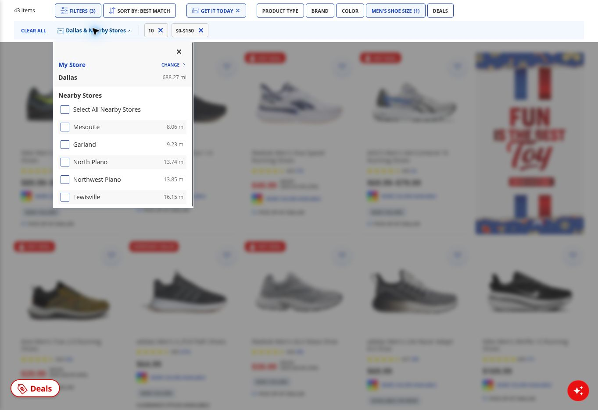
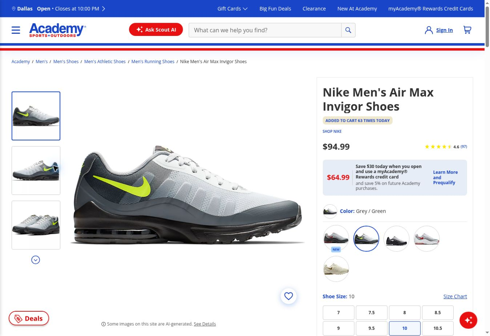
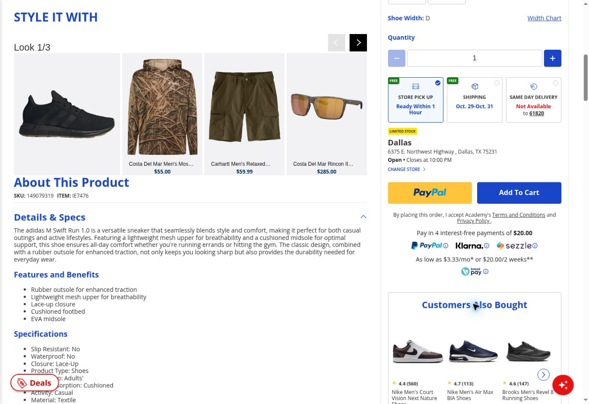
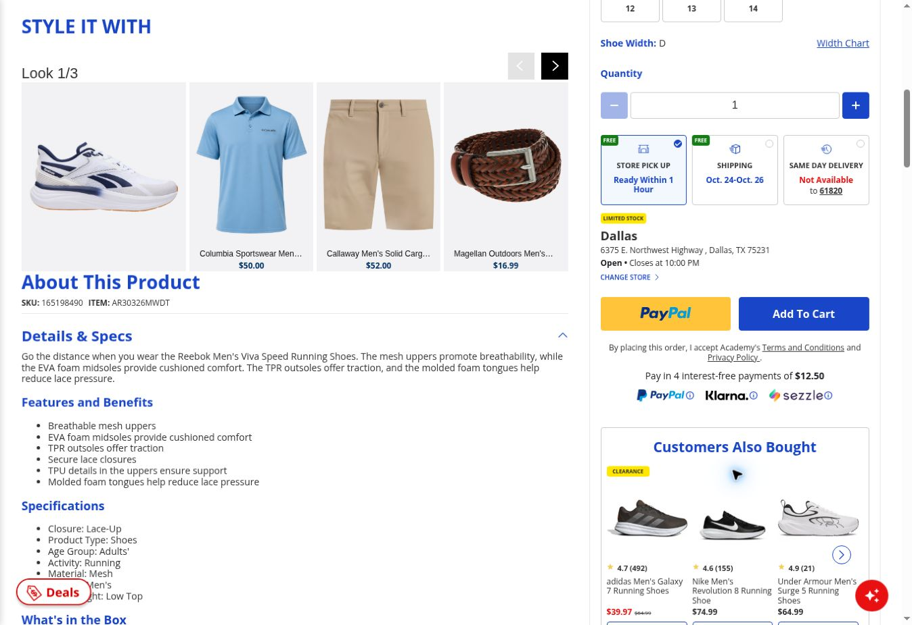

# Academy website follow-up — October 20, 2026

Source: supplied `academy-website-followup-20261020.md` and `academy-followup-raw-20261020.json`, documenting the completed ChatGPT Work desktop-browser session. This local documentation integration inspected attachments, not live retailer sources. Website interactions, browser-state captures, timestamps, and DOM measurements below are attributed to that supplied session. No new research, PRD, prototype, commit, or push was performed during integration.

The proposed focus is framed in the [provisional problem brief](../product/problem-brief.md). The [earlier pilot](online-research-pilot.md) and [historical audit](competitive-ux-audit.md) remain separate dated evidence. This report adds no FB accounts or changes to accepted-feedback totals; it does not amend the protocol or A-01.

## Recommendation

Use exact-variant pickup clarity as the provisional focus for the desktop-web portfolio concept. The evidence supports a narrow design hypothesis, not a validated customer priority or business opportunity. The first three eligible cards produced one pickup-message mismatch and two successful matches. All three retained filters and nearby-store exclusions on browser Back; none returned to the page top.

The Nike mismatch repeats the same product and session environment as the earlier pilot. It is a repeat observation, not another independent customer account or proof of a widespread defect. The two other products are useful counterexamples.

Suggested problem statement: When comparing shoes for pickup at a selected store, shoppers can see a pictured variant labeled for that store even though the exact size/color later requires a different store. The listing should make the relationship between the pictured variant, selected size, and pickup location clear before shoppers rely on it.

The last sentence is a proposed design objective. Customer comprehension, urgency, prevalence, and business effects have not been measured. No PRD, design, repository edit, commit, or push was performed in this follow-up.

## Scope and fixed selection

Researcher observation through ChatGPT Work's desktop browser, guest session, Academy men's running shoes. Existing session preferences carried over: Dallas selected, optional cookies previously rejected. No precise browser-version identification was captured. DOM viewport measured 1348 × 936 CSS pixels; screenshots are approximately 1348 × 926 image pixels. No account login, cart addition, purchase, or participant research.

Recorded interval: October 20, 2026, 7:44:41–7:49:00 PM America/Chicago. UTC interval: 2026-10-21T00:44:41.396Z through 2026-10-21T00:49:00.811Z. Sample fixed at 2026-10-21T00:45:40.759Z, before opening any sampled product.

Before inspecting product outcomes, selected the first three product cards in displayed Best Match order after applying these conditions:

- Dallas, 6375 E. Northwest Highway, TX 75231, store 78.
- Get It Today / Get It Fast pickup filter enabled.
- Select All Nearby Stores and each listed nearby store unchecked: Mesquite, Garland, North Plano, Northwest Plano, Lewisville.
- Men's shoe size 10; custom price $0–$150.
- Preserve the pictured color and automatically transferred size; no substitution of products or variants after inspecting outcomes.

The resulting sample was Nike Air Max Invigor, adidas Swift Run 1.0, and Reebok Viva Speed. None of these three displayed a sponsored badge. The final displayed count was 43. Counts describe interface output, not verified purchasable SKU totals. The initial unfiltered count was 268; pickup initially showed 116, then 78 after nearby stores were deselected. No inference is drawn from changes versus the prior pilot's initial count.

The store chip still said Dallas & Nearby Stores even with every nearby-store checkbox unchecked. Dallas displayed a distance of 688.27 miles in this session, while nearby-store distances appeared relative to Dallas. Distances were not used to infer pickup scope. The product pages confirmed the Dallas address. Shipping/same-day-delivery ZIP remained 61820 and was separate from pickup.

## Product outcomes

Each card said PICK UP AT DALLAS. The researcher clicked its title, allowed the product page to load, inspected selected size/color/width and pickup state, then used browser Back. No variant adjustments were necessary.

| Product / pictured variant | Product price | Product-page pickup message | Observation |
|---|---|---|---|
| Nike Air Max Invigor; Grey / Green; 10; D | $94.99; listing range $89.99–$94.99 | Available Nearby; Dallas email-when-available; Lewisville within one hour; accessibility label explicitly Dallas Out Of Stock | Listing-to-exact-variant pickup mismatch repeated |
| adidas Swift Run 1.0; Black; 10; D | $79.99 | Dallas ready within one hour; Limited Stock; Add To Cart enabled | Successful label/variant/store match |
| Reebok Viva Speed; White / Navy; 10; D | $49.99; reduced from $64.99 | Dallas ready within one hour; Limited Stock; Add To Cart enabled | Successful label/variant/store match |

The successful outcomes establish displayed eligibility only. Inventory accuracy, payment, actual order acceptance and fulfillment were not tested. All three selected prices were within budget and all three preserved size 10; no price-filter failure or mandatory size reselection was observed.

## Browser Back outcomes

The check covered short browse → product → Back journeys. Before each product click and after Back, read the document scroll position and the vertical position of that product's title. Reopened the pickup-store dropdown after each return and confirmed all nearby-store boxes remained unchecked. The page retained size 10, $0–$150, pickup filtering, Best Match, and 43 displayed items.

| Product | Document scroll before / after, CSS px | Product-title top before / after, CSS px | Result |
|---|---|---|---|
| Nike | 537 / 424 | 338.375 / 451.375 | Filters preserved; position shifted 113 px upward in the document |
| adidas | 424 / 424 | 451.375 / 451.375 | Filters and measured position preserved |
| Reebok | 537 / 424 | 338.375 / 451.375 | Filters preserved; position shifted 113 px upward in the document |

Position did not remain pixel-identical in two journeys, but neither returned to the page top or lost the current first-row context. The cause of the shift was not established. Dropdown interactions and page layout can affect position; these measurements describe the observed state rather than a controlled performance benchmark.

These three cards share the first row. Deep-list return, pagination, long inactivity, Home/Shop navigation, cart exits, mobile web, native apps, and the other retailers were not tested. This narrow positive result cannot resolve the prior app complaints, whose triggers differed. It supports focusing the current desktop concept where direct evidence is stronger.

## Source locators and observation times

[Filtered listing observed](https://www.academy.com/c/mens/mens-footwear/mens-athletic-sneakers/mens-running-shoes?&storeid=78&bopisEligible=1&isSTS1=1&facet=deliveryFilter:inventory_pick%3A78%20OR%20inventory_sts%3A78&facet=%27facet_mensShoeSize%27:%2710%27&facet=%27facet_Price%27:0%20TO%20150)

- [Nike Men's Air Max Invigor Shoes](https://www.academy.com/p/nike-mens-air-max-invigor-running-shoes?sku=10-d-grey-green&dmFilter=freePickUpId); observed 2026-10-21T00:46:37.074Z.
- [adidas Men's Swift Run 1.0 Shoes](https://www.academy.com/p/adidas-mens-swift-run-10-shoes?sku=10-d-black&dmFilter=freePickUpId); observed 2026-10-21T00:47:32.284Z.
- [Reebok Men's Viva Speed Running Shoes](https://www.academy.com/p/reebok-mens-viva-speed-running-shoes?sku=10-d-white-navy&dmFilter=freePickUpId); observed 2026-10-21T00:48:24.205Z.

URLs may not preserve all cookie-dependent state. Any future reproduction would need to recreate and inspect the store selector; no reproduction was performed during local integration. No live-stock stability guarantee is implied by these links.

## Captured evidence and limits

The five supplied screenshots were inspected locally and copied without changing image bytes. Repository copies use the requested sequence names below. Each SHA-256 was checked against the supplied report and the copied file. The adidas attachment is named `academy-followup-adidas-20261020 (1).jpg`; the report calls it `academy-followup-adidas-20261020.jpg`. Its bytes match the reported hash, so this is a source-filename difference, not missing image evidence.

- Repository `academy-01-filtered-listing.jpg`; source attachment `academy-followup-listing-20261020.jpg` — SHA-256 `c4d9c9b63988f6b2b53f09848cdcfd56b6e49826c6a58508e1738db4e629beca`.
- Repository `academy-02-nearby-store-settings.jpg`; source attachment `academy-followup-stores-20261020.jpg` — SHA-256 `eafe82d39d9e28c97cff385bfd600bb5593c69ca4d0ae0360d4b7678a19d4bd8`.
- Repository `academy-03-nike-product.jpg`; source attachment `academy-followup-nike-20261020.jpg` — SHA-256 `3ff7c528688291a3cb82a33e6151f483b3941b666d45ed349c68fb5edf4f6eef`.
- Repository `academy-04-adidas-pickup-match.jpg`; source attachment `academy-followup-adidas-20261020 (1).jpg` (report filename: `academy-followup-adidas-20261020.jpg`) — SHA-256 `92fcd3f697d886306bd85ba0c6768b204739fc2d3526ea609b515891007f3420`.
- Repository `academy-05-reebok-pickup-match.jpg`; source attachment `academy-followup-reebok-20261020.jpg` — SHA-256 `9df1604cd31de93ee677d4aae860b66b7310152c22c6cc87bfeb766faac80825`.

Listing and store screenshots show the sample and unchecked boxes. The Nike screenshot shows the product's upper panel, not its pickup section; use the captured accessibility evidence below for this session's explicit out-of-stock state. adidas and Reebok screenshots show the successful Dallas pickup panels. Still images establish captured states, not the interaction sequence. The walkthrough and timestamps document the sequence.

Unlike the earlier pilot integration, this follow-up preserved the underlying accessibility text and DOM position observations in the [unchanged raw JSON checkpoint](evidence/2026-10-20-academy-followup/academy-followup-raw-20261020.json). The excerpts below are selected verbatim lines from the supplied captured states, scoped to each primary selected product. Unrelated recommendation-product lines and the adidas conditional credit-card price have been omitted here; the raw JSON remains intact. Ordinary selected prices are Nike $94.99, adidas $79.99, and Reebok $49.99; conditional credit-card offers are not those ordinary prices. They are browser evidence from the researcher, not an independent inventory feed or confirmation that physical stock matched the site.

### Screenshot captures


Filtered listing: 43 items; size 10, $0–$150, pickup filtering; Nike grey/green, adidas black, and Reebok white/navy are the first three cards, each labeled “PICK UP AT DALLAS.”



Store settings: Dallas is My Store. Select All and the five listed nearby-store boxes are unchecked despite the unchanged “Dallas & Nearby Stores” chip. The displayed 688.27-mile Dallas distance does not establish a location or inventory-system cause.



Nike upper product panel: Grey / Green, selected size 10, and ordinary price $94.99; the separate $64.99 offer is conditional on a credit card. This image does not show pickup details or the width. Use the supplied JSON and scoped excerpts for D width and Dallas out-of-stock/Lewisville pickup evidence, not this screenshot or an earlier pilot capture.



adidas lower product panel: width D, Dallas “Ready Within 1 Hour,” Limited Stock, and Add To Cart displayed. Black, size 10, and ordinary $79.99 are recorded in the session JSON/excerpts; the upper selection/price panel is outside this capture. Prices in “Style It With” and “Customers Also Bought” belong to recommended items.



Reebok lower product panel: width D, Dallas “Ready Within 1 Hour,” Limited Stock, and Add To Cart displayed. White / Navy, selected size 10, and ordinary $49.99 are recorded in the session JSON/excerpts; this image does not show that complete selection/price panel. Recommended-item and installment prices are not the selected shoe's ordinary price.

### Exact pickup and selection excerpts

#### Nike Men's Air Max Invigor Shoes

```text
59 text $94.99
76 button Description:  Color Grey / Green selected , ID: ColorGrey / Green
101 checkbox Description: Shoe Size 10 selected , Value: 0, ID: Shoe Size10
114 text Shoe Width
115 text D
126 checkbox Description: store pick up, Dallas,Out Of Stock: Out Of Stock, Value: 1
127 text STORE PICK UP Available Nearby
137 text Dallas 6375 E. Northwest Highway , Dallas, TX 75231 Open Closes at 10:00 PM
139 button EMAIL ME WHEN AVAILABLE, ID: notified-button-pdp
141 radio button (settable, integer) Description: available at nearby stores, Lewisville, Ready Within 1 Hour, Value: 0
142 text Lewisville Ready Within 1 Hour 2428 South Stemmons Frwy, Lewisville, TX 75067 Open Closes at 10:00 PM
```

#### adidas Men's Swift Run 1.0 Shoes

```text
58 text Hurry! Only 2 left! $79.99
72 button Description:  Color Black selected , ID: ColorBlack
97 checkbox Description: Shoe Size 10 selected , Value: 0, ID: Shoe Size10
114 text Shoe Width
115 text D
127 checkbox Description: store pick up FREE, Dallas,Estimated Pick Up: Ready Within 1 Hour, Value: 1
129 text STORE PICK UP Ready Within 1 Hour
139 text LIMITED STOCK Dallas 6375 E. Northwest Highway , Dallas, TX 75231 Open Closes at 10:00 PM
```

#### Reebok Men's Viva Speed Running Shoes

```text
58 text Hurry! Only 1 left! Now priced  $49.99 Regularly priced  $64.99 SAVE $15.00 (23%)
75 button Description:  Color White / Navy Hot Deal selected , ID: ColorWhite / Navy
90 checkbox Description: Shoe Size 10 selected , Value: 0, ID: Shoe Size10
105 text Shoe Width
106 text D
118 checkbox Description: store pick up FREE, Dallas,Estimated Pick Up: Ready Within 1 Hour, Value: 1
120 text STORE PICK UP Ready Within 1 Hour
130 text LIMITED STOCK Dallas 6375 E. Northwest Highway , Dallas, TX 75231 Open Closes at 10:00 PM
```

### Nearby-store settings before the first product click

```text
1237 checkbox (settable, integer) Description: Select All Nearby Stores , Value: 0, ID: fNFhCd_filters250_nearbyStore_checkbox_Select All Nearby Stores
1238 checkbox (settable, integer) Description: Mesquite 8.06 mi, Value: 0, ID: fNFhCd_filters250_nearbyStore_checkbox_Mesquite
1239 checkbox (settable, integer) Description: Garland 9.23 mi, Value: 0, ID: fNFhCd_filters250_nearbyStore_checkbox_Garland
1240 checkbox (settable, integer) Description: North Plano 13.74 mi, Value: 0, ID: fNFhCd_filters250_nearbyStore_checkbox_North Plano
1241 checkbox (settable, integer) Description: Northwest Plano 13.85 mi, Value: 0, ID: fNFhCd_filters250_nearbyStore_checkbox_Northwest Plano
1242 checkbox (settable, integer) Description: Lewisville 16.15 mi, Value: 0, ID: fNFhCd_filters250_nearbyStore_checkbox_Lewisville
```

The same six unchecked controls were captured after each of the three Back actions. Back URLs matched the filtered listing URL; observed filter controls and counts are preserved in the raw checkpoint. No customer-review accounts were added or reclassified in this follow-up.

## Decision implications

| Opportunity | Evidence available for the chosen desktop surface | Remaining uncertainty |
|---|---|---|
| Exact-variant pickup clarity | One pictured-variant mismatch repeated, with two successful comparisons and explicit store exclusions | Other products/stores, backend matching rules, stock timing, customer comprehension and consequence |
| Browsing-progress preservation | Three short Back journeys retained filtering and first-row context; two modest position shifts | Prior app-specific triggers, deep scrolling, cart/navigation exits and inactivity remain untested |

The supplied report recommends a later exploratory pickup-clarity PRD and prototype. That recommendation is not executed or authorized by this documentation integration; the current deliverable is a provisional problem brief only. Define the user's task, the observed mismatch, the proposed clarification, and assumptions requiring future validation. Preserve the successful examples so the design does not add unnecessary friction when eligibility is already clear. Treat stock freshness and the ability to obtain exact-variant store data as unresolved implementation dependencies.

Additional broad review collection is not necessary before drafting that bounded concept. The portfolio should explain why this opportunity was selected from available evidence, with no invented frequency, severity score, conversion lift, or customer validation. A useful future validation proposal would test whether people can correctly identify the pickup location for a specific size/color from the current and proposed listing, without presenting that test as completed.
