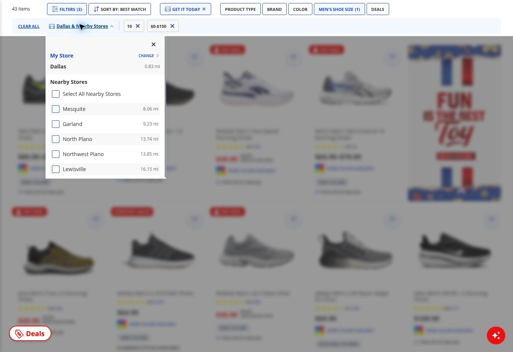
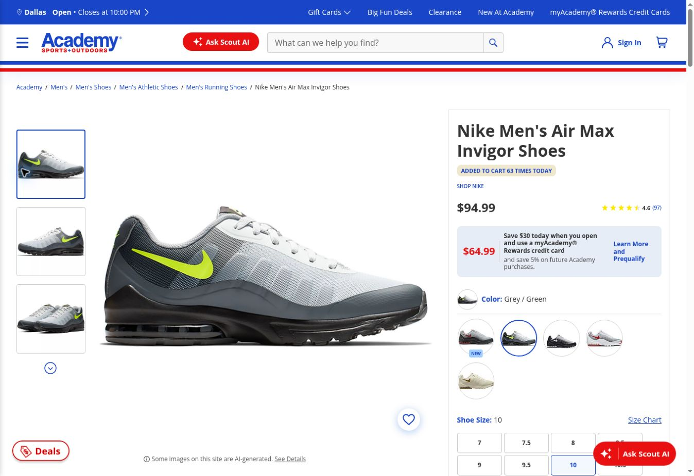
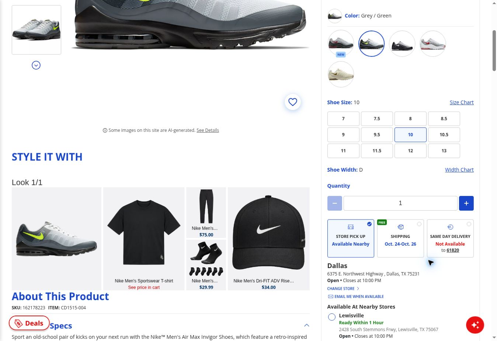

# Retail research pilot — October 20, 2026

Access date of reported pilot: 2026-10-20, America/Chicago. Source: supplied `retail-research-pilot-20261020.md`, documenting completed observations in ChatGPT Work. This local integration read the report and inspected the four supplied screenshots; it did not revisit retailer/review pages or independently verify external sources. Statements about source opening, DOM inspection, queries, and interactions below are the completed pilot's reported method and observations.

The source report's “no repository edits” statement describes that pilot session. This document integrates it locally without new research, FB IDs, final problem selection, a PRD, commits, or pushes. The six-query pilot used its reported window through October 20, 2026; it is separate from the historical protocol and Amendment A-01, not a newly approved replacement study. “Retain” dispositions below are pilot screening decisions, not formal accepted feedback records. Legacy accepted totals are unchanged. V04/V05 and SC004/SC005 in the supplied notes refer to existing V-04/V-05 and SC-004/SC-005, not new accounts.

Related records: [historical competitive audit](competitive-ux-audit.md), [synthesis](competitive-ux-synthesis.md), [feedback protocol and A-01](customer-feedback-protocol.md), and [legacy feedback analysis](customer-feedback-analysis.md).

## Pilot interpretation

Continue the repair approach. This pilot supports investigating exact-variant pickup clarity and preservation of browsing progress. It does not establish prevalence, conversion impact, or a winning solution.

The strongest new direct observation is Academy's listing-to-product pickup mismatch after explicitly deselecting nearby stores. A competing review theme is lost browsing progress. Neither should automatically become the PRD topic.

## Selection and verification

Six exact queries; one engine (system2); first five returned non-advertising web-result positions each. Positions describe tool output, not Google ranking. No replacement searches to fill a complaint quota. Window: 2024-01-01 through 2026-10-20 inclusive.

Review containers: up to first ten displayed individual reviews, without changing sentiment or sort; stop at three/four when that is all the initial page exposes. Featured and all-reviews pages logged separately; deduplicate IDs and locale/platform variants. Trustpilot's AI summary and illustrative snippets were not treated as standalone customer records.

Live Apple DOM timestamps supply years. Tables use their UTC calendar dates; visible local dates can be one day earlier. These are displayed review timestamps, not guaranteed original-publication dates for edited accounts. Google uses displayed dates. Trustpilot uses the first review timestamp, separate from experience dates inside reviews.

Apple and Trustpilot were inspected in the live browser; Google original pages were read through web retrieval, with REI also checked live. Source existence is verified, but identities, transactions, causes, inventory and app versions are not independently authenticated. “Retain” below means relevant self-report, not proven defect. App reports cannot automatically establish website behavior.

## All 30 search-result positions

### Q1: "DICK'S Sporting Goods" website shopping experience

| Position | Source | Disposition |
|---|---|---|
| 1 | [Dick's Sporting Goods rival set to close trio of stores in ruthless three-state purge](https://www.the-sun.com/money/17149712/dicks-sporting-goods-rival-closes-stores/) | Unrelated news |
| 2 | [welcome / / DICK'S Sporting Goods](https://www.dickssportinggoods.com/s/marketing/welcome?msockid=2a6023955f1262441e6235235ef3637a) | Retailer marketing |
| 3 | [welcome / / DICK'S Sporting Goods](https://www.dickssportinggoods.com/s/marketing/welcome?msockid=3a07d590688e638a0f86c3d169dc6260) | Duplicate marketing |
| 4 | [DICK'S Sporting Goods Reviews / Read Customer Service Reviews of www.dickssportinggoods.com](https://www.trustpilot.com/review/www.dickssportinggoods.com) | Screened D-TP |
| 5 | [Online Item Availability / DICK'S Sporting Goods](https://www.dickssportinggoods.com/s/item-availability?msockid=004ab78e71af61bf3b82a1cd70e060c3) | Retailer policy, not customer evidence |

### Q2: "Academy Sports + Outdoors" website shopping experience

| Position | Source | Disposition |
|---|---|---|
| 1 | [‎Academy Sports + Outdoors - Ratings & Reviews - App Store](https://apps.apple.com/us/app/academy-sports-outdoors/id1572699554?platform=iphone&see-all=reviews) | Screened A-AR |
| 2 | [Academy Sports + Outdoors Reviews / Read Customer Service Reviews of academy.com](https://www.trustpilot.com/review/academy.com) | Screened A-TP |
| 3 | [Academy Sports + Outdoors, Springfield, IL - Reviews, Ratings, Tips and Why You Should Go – Wanderlog](https://wanderlog.com/place/details/10087550/academy-sports--outdoors) | Syndicated in-store reviews; original account locators unresolved |
| 4 | [Academy Sports + Outdoors - Apps on Google Play](https://play.google.com/store/apps/details?hl=en_US&id=com.academy.android) | Screened A-GP |
| 5 | [ACADEMY SPORTS + OUTDOORS / 2021 ESG REPORT](https://corporate.academy.com/wp-content/uploads/corpresponsibility/Academy_ESG_Report_May11_2022.pdf) | Corporate report, outside window |

### Q3: "REI" website shopping experience

| Position | Source | Disposition |
|---|---|---|
| 1 | [Patagonia, Arc'teryx and The North Face are up to 50% off at REI - 27 best apparel deals for fall](https://www.tomsguide.com/wellness/fitness/patagonia-arcteryx-and-the-north-face-are-up-to-50-percent-off-at-rei-27-best-apparel-deals-for-fall) | Sale editorial |
| 2 | [REI - .www / GD](https://garyder.design/rei) | Designer case study |
| 3 | [REI Reviews / Read Customer Service Reviews of www.rei.com](https://www.trustpilot.com/review/www.rei.com) | Screened R-TP |
| 4 | [REI — eCommerce Design & Omnichannel Marketing Strategy / BASIC/DEPT® / Case Study](https://www.basicagency.com/case-studies/rei-ecommerce-web-design) | Agency case study |
| 5 | [REI.COM is the only official REI website](https://www.reddit.com/r/REI/comments/1pckm1t/reicom_is_the_only_official_rei_website/) | Background: official-site/scam post, not shopping incident; exact date unresolved |

### Q4: "DICK'S Sporting Goods" app shopping experience

| Position | Source | Disposition |
|---|---|---|
| 1 | [‎DICK’S Sporting Goods App - App Store](https://apps.apple.com/us/app/dicks-sporting-goods/id556653197) | Screened D-AF |
| 2 | [DICK'S Sporting Goods - Apps on Google Play](https://play.google.com/store/apps/details?hl=en&id=dsgui.android) | Screened D-GP |
| 3 | [How Dick’s Sporting Goods Fights Premium Sneaker Diversion with its Mobile App - Retail TouchPoints](https://www.retailtouchpoints.com/features/how-dicks-sporting-goods-fights-premium-sneaker-diversion-with-its-mobile-app/149362/) | Trade article |
| 4 | [How DICK'S Sporting Goods Launched Store Mode / Radar](https://radar.com/customers/dicks-sporting-goods) | Vendor case study |
| 5 | [DICK'S Sporting Goods – Apps on Google Play](https://play.google.com/store/apps/details?hl=en-IN&id=dsgui.android) | Duplicate D-GP locale |

### Q5: "Academy Sports + Outdoors" app shopping experience

| Position | Source | Disposition |
|---|---|---|
| 1 | [Academy Sports + Outdoors - Apps on Google Play](https://play.google.com/store/apps/details?hl=en_US&id=com.academy.android) | Duplicate A-GP |
| 2 | [‎Academy Sports + Outdoors App - App Store](https://apps.apple.com/us/app/academy-sports-outdoors/id1572699554) | Screened A-AF |
| 3 | [Academy Sports + Outdoors - Apps on Google Play](https://play.google.com/store/apps/details?id=com.academy.android) | Duplicate A-GP |
| 4 | [‎Academy Sports + Outdoors - Ratings & Reviews - App Store](https://apps.apple.com/us/app/academy-sports-outdoors/id1572699554?platform=iphone&see-all=reviews) | Duplicate A-AR |
| 5 | [‎Academy Sports + Outdoors App - App Store](https://apps.apple.com/us/app/academy-sports-outdoors/id1572699554?platform=watch) | Duplicate Academy app/platform |

### Q6: "REI" app shopping experience

| Position | Source | Disposition |
|---|---|---|
| 1 | [Save up to 20 percent on gift cards for REI, Barnes & Noble, and more](https://www.theverge.com/gadgets/1010749/google-play-gift-card-deal-sale) | Gift-card editorial |
| 2 | [Patagonia, Arc'teryx and The North Face are up to 50% off at REI - 27 best apparel deals for fall](https://www.tomsguide.com/wellness/fitness/patagonia-arcteryx-and-the-north-face-are-up-to-50-percent-off-at-rei-27-best-apparel-deals-for-fall) | Duplicate Q3 sale editorial |
| 3 | [REI Co-op – Shop Outdoor Gear - Apps on Google Play](https://play.google.com/store/apps/details?id=com.ubermind.rei) | Screened R-GP |
| 4 | [‎REI Co-op – Shop Outdoor Gear - Ratings & Reviews - App Store](https://apps.apple.com/us/app/rei-co-op-shop-outdoor-gear/id404849387?platform=iphone&see-all=reviews) | Screened R-AR |
| 5 | [‎REI Co-op – Shop Outdoor Gear App - App Store](https://apps.apple.com/us/app/rei-co-op-shop-outdoor-gear/id404849387) | Screened R-AF |

## Review screening log

Entries remain in displayed order. R = retain relevant self-report; A = adjacent/context, not direct discovery evidence; X = exclude; D = duplicate. Positive and mixed experiences are retained. Apple ID + page + title provide a locator if ordering changes; Google reviewer/date/excerpt locators are weaker than permalinks. No Google individual-review permalink was obtained.

### A-AR — Academy Apple all-reviews

[Original page](https://apps.apple.com/us/app/academy-sports-outdoors/id1572699554?see-all=reviews&platform=iphone)

| # | Review ID / UTC date / title | Disposition |
|---|---|---|
| 1 | 14651988461 / 2026-10-11 / Online shopping | R positive: explicitly website, easy account/purchase. |
| 2 | 14475643196 / 2026-08-26 / Love it | A positive: deal/shipping; interface unspecified. |
| 3 | 14452453571 / 2026-08-20 / So respectfully… | X: no interpretable discovery incident. |
| 4 | 14339606786 / 2026-07-23 / Great | A: physical-store service. |
| 5 | 14365161104 / 2026-07-30 / App is SLOW | R mixed: slow load, filters lost; existing V05/SC005. |
| 6 | 13999210060 / 2026-04-26 / Clunky payment system! Needs work!! | A: payment/authentication. |
| 7 | 14660759736 / 2026-10-13 / Pricing never matches | R qualified: price transition; separate pickup-selection report. |
| 8 | 14303158975 / 2026-07-14 / Unnecessarily requiring mobile#s | A/emergent: account barrier; motives unverified. |
| 9 | 14210749222 / 2026-06-21 / Store and Stock functions are poor | R qualified: stock/store visibility; existing V04/SC004. |
| 10 | 14087540271 / 2026-05-21 / Worst Retail App Available | A: human checks/payment interaction. |

### A-AF — Academy Apple featured

[Original page](https://apps.apple.com/us/app/academy-sports-outdoors/id1572699554)

| # | Review ID / UTC date / title | Disposition |
|---|---|---|
| 1 | 14452453571 / 2026-08-20 / So respectfully… | D: A-AR3, excluded. |
| 2 | 13028962199 / 2025-08-17 / Redeeming Rewards | A: rewards/payment error, unclear explanation. |
| 3 | 10459915981 / 2023-10-10 / Why is “Hide OUT OF STOCK” an option if still shown?! | X: outside window despite relevance to pickup hypothesis. |
| 4 | 9882517080 / 2023-05-01 / Let's see now | X: outside window. |

The 2023 stock-filter account must not be silently accepted because it supports C1. It could only be preserved later as explicitly historical context.

### D-AF — DICK'S Apple featured

[Original page](https://apps.apple.com/us/app/dicks-sporting-goods/id556653197)

| # | Review ID / UTC date / title | Disposition |
|---|---|---|
| 1 | 14040931151 / 2026-05-08 / Great people, good raffles | A positive: physical-store service. |
| 2 | 2945686473 / 2018-07-21 / I had to give 1… | X: outside window, physical-store incident. |
| 3 | 14468221651 / 2026-08-24 / My Sportings Goods #1 Store | A: physical product/service. |
| 4 | 11759907591 / 2024-09-24 / Clunky app, inventory never accurate | R: Back returns to results top; separate payment/cancellation content. |

### R-AR — REI Apple all-reviews

[Original page](https://apps.apple.com/us/app/rei-co-op-shop-outdoor-gear/id404849387?see-all=reviews&platform=iphone)

| # | Review ID / UTC date / title | Disposition |
|---|---|---|
| 1 | 14621158399 / 2026-10-03 / Awesome App | R positive: remote gear discovery. |
| 2 | 14402893546 / 2026-08-08 / Great app and gear | R positive: specifications help assess carry weight. |
| 3 | 14024112016 / 2026-05-03 / The great outdoor experience | R mixed: useful reviews; unspecified app criticism. |
| 4 | 14049114699 / 2026-05-10 / Poor Design | R: category image cropping/navigation preference. |
| 5 | 14655840641 / 2026-10-12 / Almost good | A: loading failure, device specified. |
| 6 | 14194981693 / 2026-06-17 / My favorite store | R positive: finds needed products easily. |
| 7 | 14137559552 / 2026-06-03 / Quality outdoor gear | A positive: general ease/alerts. |
| 8 | 14300275065 / 2026-07-14 / Functional App | R mixed: filtered search resets after time away. |
| 9 | 14279859530 / 2026-07-08 / Exceptional | A: physical-store service. |
| 10 | 14659757318 / 2026-10-13 / Very useful and easy to use | A positive: history/locator aided exchange. |

“Functional App” begins with an update: timestamp does not establish original publication. Preserve its search praise alongside the reset complaint.

### R-AF — REI Apple featured

[Original page](https://apps.apple.com/us/app/rei-co-op-shop-outdoor-gear/id404849387)

| # | Review ID / UTC date / title | Disposition |
|---|---|---|
| 1 | 10302060349 / 2023-08-26 / Much improved | X outside window. |
| 2 | 12220514931 / 2025-01-23 / Very useful, but could be better | R mixed: easy browsing; touch/scroll friction. |
| 3 | 11090016199 / 2024-03-27 / Clean, easy, fast, & functional | R positive: filters, details, historical comparison. |
| 4 | 8049158148 / 2021-11-21 / Please don't change to be like the others! | X outside window. |

### Google Play — initial three per app

| Source | # / reviewer / displayed date | Disposition |
|---|---|---|
| [A-GP](https://play.google.com/store/apps/details?hl=en_US&id=com.academy.android) | 1 / Blake Garrett / 2024-12-30 | R emergent: restricted-category app/browser routing; not shoe-pickup evidence. |
| A-GP | 2 / Kelly Sampson / 2026-06-25 | Similar category routing; retailer attributes restrictions to platform, cause unverified. |
| A-GP | 3 / beach lover / 2026-04-27 | A: store-card repayment. |
| [D-GP](https://play.google.com/store/apps/details?hl=en&id=dsgui.android) | 1 / Lavanya K / 2026-08-01 | A: rewards correction/support. |
| D-GP | 2 / PJ S. / 2026-04-16 | A: heavy-item shipping-charge surprise. |
| D-GP | 3 / Tyler Granville / 2026-01-27 | R: shoe navigation loops to raffle; stock/cause unverified. |
| [R-GP](https://play.google.com/store/apps/details?id=com.ubermind.rei) | 1 / Ivan Webber / 2026-04-22 | A: payment autofill/wallet support. |
| R-GP | 2 / Mary Sparks / 2024-11-05 | R mixed: items fail to open; reports website works. |
| R-GP | 3 / Kai J. Lee / 2022-11-24 | X outside window. |

A cached REI search preview showed a Charlie Meienberg price-transition review dated 2026-03-13. It was absent from the subsequently opened original page and live browser sample. **Unverified lead only, not retained.** No extra searching to recover a desirable complaint.

### Trustpilot — ten standalone reviews each

All read in live browser. URLs identify individual accounts. Dates below are review timestamps, not dates of experience. No AI summaries counted.

#### D-TP

| # | Individual original source | Review date | Disposition |
|---|---|---|---|
| 1 | [6ad76a6e3b42a716b4e58baf](https://www.trustpilot.com/reviews/6ad76a6e3b42a716b4e58baf) | 2026-10-20 | X workplace allegations |
| 2 | [6ac80867e36054266281d995](https://www.trustpilot.com/reviews/6ac80867e36054266281d995) | 2026-10-08 | A packaging |
| 3 | [6ac6ae3f655aace2f2e81029](https://www.trustpilot.com/reviews/6ac6ae3f655aace2f2e81029) | 2026-10-07 | A billing/support |
| 4 | [6ab93f69e742af0a87eb0410](https://www.trustpilot.com/reviews/6ab93f69e742af0a87eb0410) | 2026-09-27 | A in-store staffing |
| 5 | [6ab909ae33bb272c6c03e6c8](https://www.trustpilot.com/reviews/6ab909ae33bb272c6c03e6c8) | 2026-09-27 | X customization-policy objection; insufficient journey context |
| 6 | [6ab4de0fea7a3b6d1521ee1f](https://www.trustpilot.com/reviews/6ab4de0fea7a3b6d1521ee1f) | 2026-09-24 | A in-store pricing/wrong treadmill |
| 7 | [6aad345645430096fe515ebe](https://www.trustpilot.com/reviews/6aad345645430096fe515ebe) | 2026-09-18 | A shipping-threshold communication/cancellation |
| 8 | [6aa97dd1c4622478e1ffb747](https://www.trustpilot.com/reviews/6aa97dd1c4622478e1ffb747) | 2026-09-15 | A packaging/disclosure uncertainty |
| 9 | [6aa5a48bc4639f108fc0978c](https://www.trustpilot.com/reviews/6aa5a48bc4639f108fc0978c) | 2026-09-12 | A nonspecific returns |
| 10 | [6a9e44e28cca53e2d6e0467e](https://www.trustpilot.com/reviews/6a9e44e28cca53e2d6e0467e) | 2026-09-07 | A checkout-address change report/cancellation |

#### A-TP

| # | Individual original source | Review date | Disposition |
|---|---|---|---|
| 1 | [6ad7c4ac7371bf7aede3c600](https://www.trustpilot.com/reviews/6ad7c4ac7371bf7aede3c600) | 2026-10-20 | A positive assistance; channel unclear |
| 2 | [6ad3f3615eea8b59677925f5](https://www.trustpilot.com/reviews/6ad3f3615eea8b59677925f5) | 2026-10-18 | X unclear application/service incident |
| 3 | [6ac00067a511f749be43876d](https://www.trustpilot.com/reviews/6ac00067a511f749be43876d) | 2026-10-02 | A in-store footwear return |
| 4 | [6aab3ca3987ae4b564cb6567](https://www.trustpilot.com/reviews/6aab3ca3987ae4b564cb6567) | 2026-09-17 | A regulated in-store purchase process |
| 5 | [6aab3b2a48b04e8497375169](https://www.trustpilot.com/reviews/6aab3b2a48b04e8497375169) | 2026-09-17 | D apparent repeat of #4: same narrative, near-identical timing |
| 6 | [6aaaf820bc367176bd41938c](https://www.trustpilot.com/reviews/6aaaf820bc367176bd41938c) | 2026-09-16 | A reorder price increase/cancellation |
| 7 | [6aaadb62a2c66feb43d43f2b](https://www.trustpilot.com/reviews/6aaadb62a2c66feb43d43f2b) | 2026-09-16 | A mixed: simple online ordering, packaging complaint |
| 8 | [6aa1d94ece50bc75c76910f0](https://www.trustpilot.com/reviews/6aa1d94ece50bc75c76910f0) | 2026-09-10 | A cancellations/refunds |
| 9 | [6aa05530e0635ea4a92ae51a](https://www.trustpilot.com/reviews/6aa05530e0635ea4a92ae51a) | 2026-09-08 | X physical-store complaint escalation |
| 10 | [6aa04366c375d5fc158afa3b](https://www.trustpilot.com/reviews/6aa04366c375d5fc158afa3b) | 2026-09-08 | A regulated in-store payment process |

#### R-TP

| # | Individual original source | Review date | Disposition |
|---|---|---|---|
| 1 | [6ad277233bcf18c1ce2ca2e8](https://www.trustpilot.com/reviews/6ad277233bcf18c1ce2ca2e8) | 2026-10-16 | A positive product durability |
| 2 | [6ac5753027d2d8e41144fc25](https://www.trustpilot.com/reviews/6ac5753027d2d8e41144fc25) | 2026-10-07 | A website card-country/payment mismatch; cause unverified |
| 3 | [6aaee0e6ca96d7bfd9e3aaa0](https://www.trustpilot.com/reviews/6aaee0e6ca96d7bfd9e3aaa0) | 2026-09-19 | A backorder notification/cancellation |
| 4 | [6aaeb5324ac316743e39b600](https://www.trustpilot.com/reviews/6aaeb5324ac316743e39b600) | 2026-09-19 | A positive checkout/tracking |
| 5 | [6aa621217095cc137ad4e1df](https://www.trustpilot.com/reviews/6aa621217095cc137ad4e1df) | 2026-09-13 | Qualified boundary account: alleges missing prepurchase backorder disclosure; original UI absent |
| 6 | [6a99cd7c505e554284d77957](https://www.trustpilot.com/reviews/6a99cd7c505e554284d77957) | 2026-09-03 | A wrong order/support |
| 7 | [6a910fdae84b9761ea48e8f2](https://www.trustpilot.com/reviews/6a910fdae84b9761ea48e8f2) | 2026-08-28 | A empty delivery |
| 8 | [6a8e532b8cc63969358e160f](https://www.trustpilot.com/reviews/6a8e532b8cc63969358e160f) | 2026-08-26 | A used-product quality/return |
| 9 | [6a85d41b78097bea5250cbfe](https://www.trustpilot.com/reviews/6a85d41b78097bea5250cbfe) | 2026-08-19 | A positive staff recommendations |
| 10 | [6a81eeeb77e455b65164bc25](https://www.trustpilot.com/reviews/6a81eeeb77e455b65164bc25) | 2026-08-16 | A in-store return discretion |

## Controlled Academy website check

Targeted check of the earlier pictured Nike product, not a random product sample or a full competitive re-audit. Guest desktop web; screenshots 1348 × 926. Rejected optional cookies. No purchase/account creation. Access date above; exact start/end times not logged, so no time-stable-inventory claim.

1. Selected Dallas: 6375 E. Northwest Highway, TX 75231, store 78. Shipping/same-day ZIP remained 61820, separate from pickup.
2. Category initially displayed 552 items. Get It Today produced 116 after loading. Nearby-store selector initially checked Select All, Mesquite, Garland, North Plano, Northwest Plano, Lewisville.
3. Deselected Select All. Reopened/inspected selector: all nearby-store boxes unchecked. Count settled at 78. Chip still read Dallas & Nearby Stores: **chip text alone is not reliable evidence of nearby-store inclusion**.
4. Applied size 10 and $0–$150: 43 displayed items. These are interface counts, not verified unique purchasable variants.
5. Pictured grey/green Nike Air Max Invigor appeared first, $89.99–$94.99, labeled PICK UP AT DALLAS. Selected deliberately to test prior concern, not as a representative random choice.
6. Product opened with **Grey / Green, size 10, width D, $94.99**. Size transferred automatically. Pickup said Available Nearby; Dallas offered email-when-available; Lewisville offered readiness within one hour. Accessibility label explicitly said Dallas Out Of Stock. Product SKU: 162178223; item CD1515-004.

[Observed listing URL](https://www.academy.com/c/mens/mens-footwear/mens-athletic-sneakers/mens-running-shoes?&storeid=78&bopisEligible=1&isSTS1=1&facet=deliveryFilter:inventory_pick%3A78%20OR%20inventory_sts%3A78&facet=%27facet_mensShoeSize%27:%2710%27&facet=%27facet_Price%27:0%20TO%20150)

[Observed product URL](https://www.academy.com/p/nike-mens-air-max-invigor-running-shoes?sku=10-d-grey-green&dmFilter=freePickUpId)

URLs may not retain every checkbox/cookie state; any future reproduction would need to recreate and inspect the store dropdown. No reproduction was performed during integration. Captured screenshots: academy-pilot-listing-20261020.jpg; academy-pilot-store-settings-20261020.jpg; academy-pilot-product-20261020.jpg; academy-pilot-pickup-evidence-20261020.jpg. Copies are embedded below under `screenshots/2026-10-20-online-pilot/`; the original image bytes and filenames are preserved.

**Pilot-reported interaction:** pictured variant in selected-store pickup results with Dallas label opened with Dallas email notification and nearby-store availability. The report separately records an accessibility label explicitly identifying Dallas as out of stock; the screenshots do not display that label. **Reasonable interpretation:** the listing-to-product sequence presents a specific exact-variant pickup clarity concern. Product-family eligibility may overstate pictured-variant eligibility, but the matching mechanism was not established. **Unresolved:** matching rules, inventory timing, other variants, frequency, actual customer interpretation. No backend defect established. **Counterexample:** automatic size transfer does not support the original size-reselection concern in this journey.

## Attached Academy screenshot evidence

These four supplied screenshots were inspected locally during documentation integration. They establish captured visible states, not the actions between them or original-source verification. Selection/deselection order and automatic size transfer are reported walkthrough interactions. The explicit Dallas out-of-stock accessibility label is reported from the accessibility tree in ChatGPT Work, not visible text in these images. No accessibility-tree export was supplied.

Listing: 43 items, size 10, $0–$150, Get It Today, and the pictured grey/green Nike card at $89.99–$94.99 with “PICK UP AT DALLAS.” The chip still says “Dallas & Nearby Stores.”

Store settings: Dallas is My Store; Select All Nearby Stores and all five listed nearby-store boxes are unchecked while the chip retains “Dallas & Nearby Stores.” The report records explicitly unchecking these boxes; the screenshot establishes the resulting state. This later capture does not retrospectively prove the original October 18 settings.

Product: Nike Air Max Invigor, $94.99, Grey / Green and size 10 selected. Automatic transfer is reported by the pilot; a still image alone does not prove transfer.

Pickup: Grey / Green, size 10, width D; Store Pick Up selected with “Available Nearby.” Dallas offers “EMAIL ME WHEN AVAILABLE”; Lewisville shows “Ready Within 1 Hour.” Same-day delivery ZIP 61820 is separate from the Dallas pickup store. “Dallas Out Of Stock” is an accessibility-tree report, not visible text in this capture. The screenshot also shows SKU 162178223 and item CD1515-004.

## Synthesis and next action

Browsing-progress reports span DICK'S results position, Academy navigation/filter loss, and REI inactivity/reset. Different triggers; do not claim a shared defect. Academy V05 and V04 were rediscovered, not newly independent evidence. Broader progress preservation is an emergent framing, not confirmation of C3's specific size-reselection hypothesis.

Academy's Pricing never matches reports web and app sale-price transitions. Qualify it: exact SKU, price-filter behavior and cause are unverified. Keep its pickup complaint separate. Positive REI product-information/filter accounts and Academy website success constrain broad failure claims.

This is search-ranked convenience sampling of self-selected public reviewers. Broad queries reduce candidate prompting but platform ranking, recency, negativity, accessibility and language still shape yield. Different review-container depths make retailer/issue-rate comparisons invalid. Cached previews differed from live pages. No claim of a timed 90-minute study or of a quota proving saturation.

Proposed next phase from the supplied report (not executed or newly authorized by this integration):

1. Review pilot, then document it through local Codex → VS Code → GitHub Desktop. Do not auto-promote every retained account into accepted FB evidence.
2. Compare two bounded follow-ups before choosing a PRD: exact-variant pickup clarity and preservation of browsing progress. Fix the intended retail surface first; app evidence does not validate desktop web.
3. For pickup, preselect a few cards by a fixed rule, e.g. first three in a stated filtered list. Preserve pictured color, selected size, budget, pickup store and nearby-store checkbox states. Record successes and mismatches; no replacing cards until a failure appears.
4. For progress, specify browse → product → Back and leave → return scenarios on the chosen surface. Record both preserved and lost state. If native-app access is unavailable, report secondary app evidence without claiming direct reproduction.
5. Choose a narrow problem using evidence specificity, reported consequence, surface relevance and prototype feasibility. Further online research should use fixed query/page budgets, not complaint quotas. Proposed success measures and validation must remain proposals.

A no-interview portfolio can credibly present secondary-source discovery, observed interfaces, design hypotheses and a prototype. It cannot claim customers have validated the solution without that evidence.
